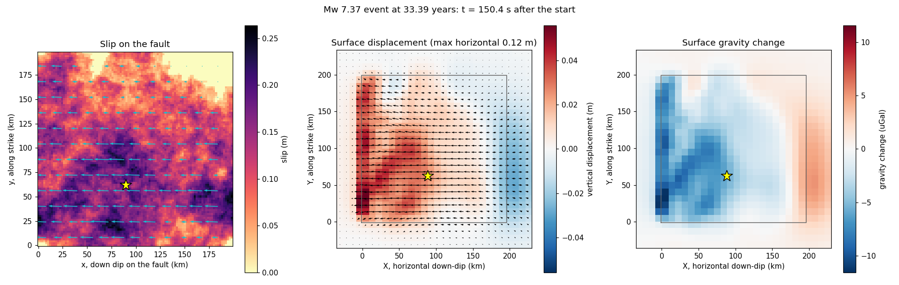
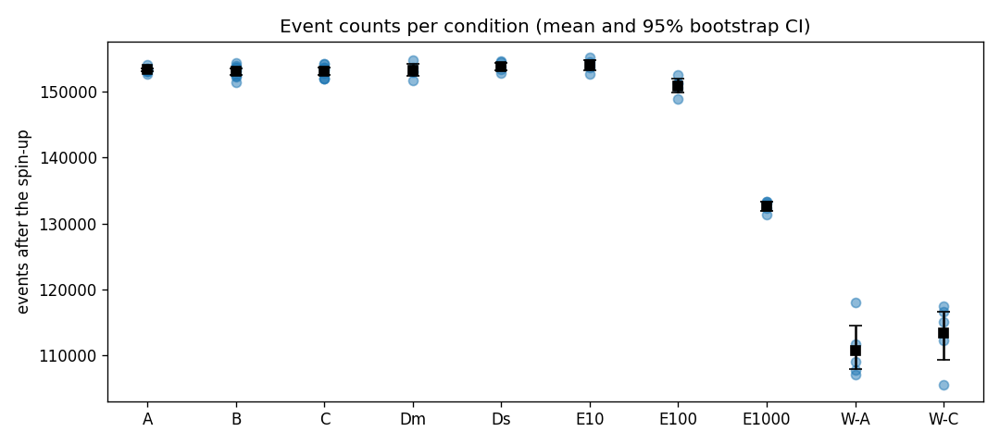
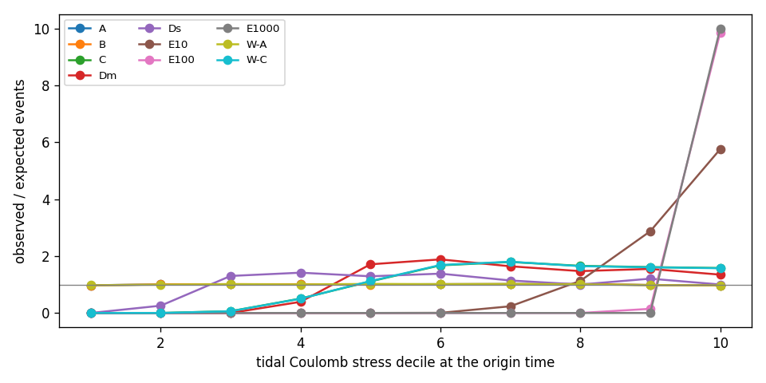
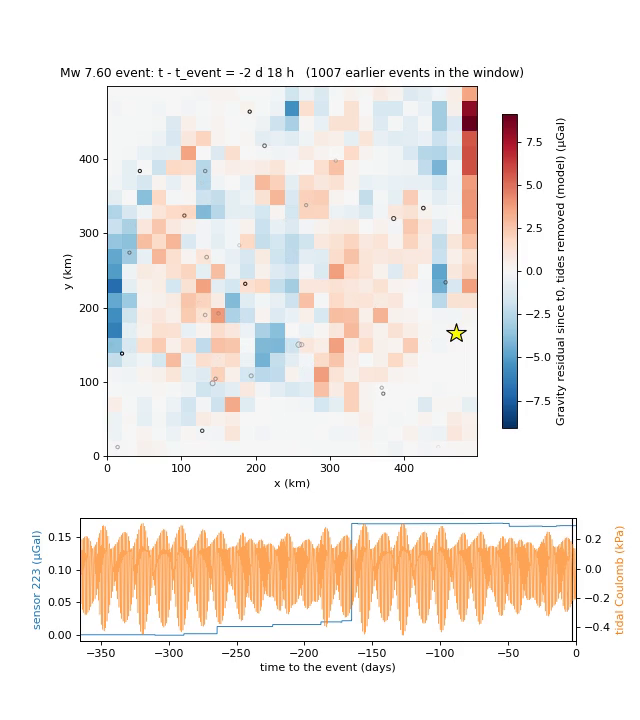

# Burridge-Knopoff Earthquake Simulation with Gravity Sensors

A two-dimensional Burridge-Knopoff spring-block earthquake model, with an
array of gravity sensors that record the changes in gravitational potential
and gravity caused by the motion of the fault, optional Earth-tide forcing by
the Moon and the Sun, and tools from nonlinear dynamics to study it.

- 250 × 250 blocks (a 500 km × 500 km fault patch) loaded by a plate moving at
  9 cm/year, with heterogeneous friction
- event-driven integration: the default 100-year run takes about 3 minutes and
  about 130 MB of memory (a 100 × 100 grid: about 10 s)
- an event catalogue with seismic moment and moment magnitude, and
  magnitude-frequency statistics (b-value, completeness, local slopes)
- exact potential and gravity changes at a 25 × 25 sensor array (one every 20 km) 5 km above the fault
- Earth tides (Moon and Sun): tidal shear, unclamping and body force on the blocks, steps of at
  most one hour between events, tidal statistics of the catalogue
- an animation of the gravity in the year before an event, one frame per hour (tides removed)
- strain build-up and precursory slip (optional): the gravity of fault slip in an elastic
  half-space, including the slip deficit that grows between events (Okada, 1985; Okubo, 1992;
  Savage, 1983), and rate-and-state nucleation creep of the blocks before they fail
  (Dieterich, 1992)
- maps and animations of the displacement vector field during an event: slip on the fault,
  surface displacement and surface gravity
- nonlinear dynamics: Lyapunov exponents, embedding, recurrence, synchronisation and
  information flow (with the CaMI toolbox)
- NPZ/CSV output, animations, event maps and magnitude-frequency plot
- 213 tests (plus time/memory/statistics budgets), including analytic checks of the dynamics


## Quick start

```bash
pip install -r requirements.txt
python main.py                       # defaults from config.py, about 4-7 min with plots
python main.py --nx 50 --ny 50 --years 50 --output small_run
python main.py --help
```

Results go to `output/data` (data) and `output/plots` (figures and animation).

From Python:

```python
from burridge_knopoff import SimulationConfig, run, save_results

result = run(SimulationConfig(n_blocks_x=50, n_blocks_y=50, simulation_years=100, seed=1),
             progress=True)   # optional progress bar (simulated years, event count)
print(len(result.events), max(e.magnitude for e in result.events))
result.potentials            # (samples, sensors) potential change, J/kg
result.gravity               # (samples, sensors) change of the downward gravity, m/s^2
result.catalogue             # structured array of events

tidal = run(SimulationConfig(n_blocks_x=50, n_blocks_y=50, tides=True))   # Moon and Sun tides
creep = run(SimulationConfig(n_blocks_x=50, n_blocks_y=50, preslip=True,  # creep before failures,
                             gravity_model='dislocation'))                # gravity of the slip deficit
save_results(result, 'my_run')
```

## Requirements

- Python 3.9 or later
- numpy (≥ 1.22), numba (≥ 0.56), matplotlib (≥ 3.5), tqdm (≥ 4.40, progress bar): `pip install -r requirements.txt`,
  or `pip install .` to also get the `burridge-knopoff` command
- optional: FFmpeg for an MP4 animation (otherwise a GIF is written; the
  pre-seismic animation needs it)
- optional, for `burridge_knopoff.dynamics`: scipy, and for information flow
  [cami](https://github.com/artvalencio/cami-python) ≥ 1.5 and
  [coupledlogistic](https://github.com/artvalencio/coupledlogistic) (`pip install .[dynamics]`)

## The model

Each block *i* sits on the fault plane z = 0 and slides along x, the direction
of plate motion. Its displacement from the reference grid is uᵢ and its velocity
vᵢ ≥ 0. The forces on it are

| Force | Expression |
|---|---|
| coupling springs (free edges) | Σⱼ k_ij (uⱼ − uᵢ); by default k_ij = k_c for the 4 nearest neighbours |
| loading ("leaf") spring to the plate | k_p (x_p(t) − uᵢ), x_p(t) = x_p(0) + v_p t |
| friction | stuck: holds the block up to its strength F_s,i; slipping: f_i(v) against the motion, by default F_d |

The plate starts at x_p(0) = F_d/k_p, so every block starts at the dynamic
friction level. Strengths are heterogeneous, F_s,i = F_d + (F_s − F_d)·U[1 − h, 1 + h],
drawn with a seed. By default a block that has slipped heals with a new
strength, never below the load it holds when it stops.

**Optional physics.**

- **Velocity-weakening friction** (`weakening_velocity_m_s` = v_w, `onset_drop` = s,
  after Carlson & Langer, 1989). While a block slips, friction is

      f_i(v) = F_d + (1 − s)(F_s,i − F_d) / (1 + v / v_w)

  It drops by the fraction s of the strength excess when slip starts (that drop
  is what lets slip begin), then weakens towards F_d as the block speeds up.
  Very slow weakening behaves like constant friction at the onset level; very
  fast weakening tends to the default F_d. Both limits are tested.
- **Long-range stress transfer** (`interaction_range_blocks` = R,
  `interaction_exponent` = p, default 3). Every pair of blocks within R
  spacings is coupled with k_ij = k_c (L/r_ij)^p. With p = 3 this is the 1/r³
  decay of static stress transfer in an elastic body. R = 1 is the classic
  nearest-neighbour model; R = 3 couples 28 blocks, R = 5 couples 80.

**Event-driven integration.** While all blocks are stuck, only the plate moves
and every force grows at the rate k_p v_p. The time until the weakest block
fails is therefore known exactly, and the simulation jumps there. The slip is
then integrated with velocity Verlet, only for the slipping blocks, with steps
of 1/100 of the fastest oscillation period. A block stops when its velocity
returns to zero with its force within its strength; a stuck neighbour starts
when its force exceeds its strength. The event ends when no block moves.

**Events.** The hypocentre is the first failing block. The seismic moment is
M₀ = μ · A · Σ slip (shear modulus, block area), and the moment magnitude is
Mw = (2/3)(log₁₀ M₀ − 9.1).

**Gravity.** Each block is a point mass m, and the sensors record

    ΔΦ_s = −G m Σ_b ( 1/|r_s − r_b − u_b x̂| − 1/|r_s − r_b| ).

Blocks are stuck between events, so ΔΦ only changes at events (unless they creep, or
gravity follows the slip deficit: see Strain build-up and precursory slip). After each
event it is updated from the slipped blocks alone. Every term is evaluated in
a cancellation-free form, never as the difference of two large totals. The
acceleration is g = −∇Φ, pointing towards the masses (`gravity.acceleration`).
The sensors also record the change of the downward gravity a gravimeter
measures, Δg_s = G m Σ_b d_z (1/|r_s − r_b − u_b x̂|³ − 1/|r_s − r_b|³),
computed in the same pass and in the same cancellation-free way. Each event's
co-seismic step is summarised in the catalogue (largest and RMS |Δg| over the
sensors); events above `gravity_map_min_magnitude` keep their full maps.

## Earth tides

With `tides=True` (`--tides`), the Moon and the Sun deform the Earth and load
the fault (`burridge_knopoff/tides.py`):

- **Positions** of the bodies from low-precision analytic series (Meeus, 1998;
  ~0.01° for the Moon), rotated to the Earth-fixed frame by the sidereal time.
- **Tidal potential** (degree 2, and 3 for the Moon) and the **strain** of the
  elastic Earth from the Love/Shida numbers h₂, l₂; plane **stress** at the free
  surface (σ ≈ 2μ ε), a few kPa.
- **On the fault** (nominal orientation, default the 2011 Tohoku-oki mechanism,
  strike 203°, dip 10°, rake 88°, centred at 38.3° N, 143° E): the shear
  stress τ along the slip drives the blocks, the normal stress σ_n (tension
  positive) unclamps them, lowering the static strength by μ_s σ_n A and the
  sliding friction by μ_d σ_n A, and the tidal acceleration acts on the block
  masses (about 1 % of the stress term). On a 10° thrust the shear is ±~0.4 kPa
  and the normal stress ±~0.07 kPa.
- **Integration.** The tide is tabulated every `tide_step_hours` (at most 1 h
  by default) on a 3 × 3 grid of control points, fitted linearly over the area,
  and interpolated by cubics in between. Between events the plate is stepped
  through the table, and the first failure inside a step is found exactly on
  the interpolated tide, so no short excursion above the strength is missed.
  During an event (seconds) the tide is frozen.
- **Statistics** (`burridge_knopoff.tide_analysis`): the catalogue records the
  tide at each hypocentre and its semidiurnal phase; `tidal_statistics` gives
  the Schuster test and the event rate per tidal-stress decile, and applies
  the same tide to a run without tides as a null control.

The harmonic constituents of the computed tide match Cartwright & Edden (1973)
(M2/S2 2.150, K1/O1 1.406 over a nodal cycle), and the tidal gravity spans
about 300 µGal peak to peak at the site.

## Pre-seismic gravity

`python main.py --preseismic [EVENT]` replays the run up to an event (the
largest after the spin-up by default; runs are deterministic for a seed) and
records the sensors every hour of the year before it
(`burridge_knopoff.preseismic.replay`). The animation
(`visualization.preseismic_animation`, MP4) shows the gravity change since
the start of the window; with tides it shows the gravity residuals, the tide
removed exactly (`--tide-removal model`) or by a least-squares fit of the main
constituents as for real data (`fit`). The series at the sensor nearest the
hypocentre runs below the map. With the default point-mass gravity the field
only changes at the events of the window (blocks are stuck in between); with
`--gravity-model dislocation` it also follows the growing slip deficit, and with
`--preslip` the creep of the blocks before they fail.

## Strain build-up and precursory slip

Two optional additions make gravity change between earthquakes.

**Gravity of the slip deficit** (`gravity_model='dislocation'`,
`--gravity-model dislocation`; `burridge_knopoff/dislocation.py`). Each block is
a 2 km × 2 km patch of a planar thrust in an elastic half-space, dipping at
`fault_dip_deg` (10°) from a top edge at `fault_top_depth_m` (5 km) and slipping
along `fault_rake_deg` (88°). On the fault, x runs down dip and y along strike.
The sensors lie on the free surface above: X horizontal and down dip, Y along
strike. The gravity change at a point of the deforming surface is Okubo's
(1992) closed form, which includes:
- the density change from the dilatation,
- the raised or lowered surface layer,
- the free-air change of the gravimeter's height (0.3086 mGal/m).

The surface displacements are Okada's (1985).

In the back-slip picture (Savage, 1983), steady slip of the whole interface at
the plate rate only moves the plates rigidly. The deformation is therefore that
of the slip deficit:

    Δg_s(t) = Σ_b G_sb [u_b(t) − u_b(0) − (x_p(t) − x_p(0))]

Here G_sb is the gravity at sensor s per metre of slip on block b. It is
computed once (float32; 156 MB and 4 s for the default grid).

- **Between events:** gravity changes steadily, by about 3 µGal per year at the
  default sensors (4.5 at most).
- **At each event:** part of the accumulated deficit is released.
- **Over many cycles:** the blocks keep up with the plate, so the field stays
  bounded. The point-mass gravity, by contrast, drifts at the free edges: ±7 µGal
  against ±80 µGal after 30 years on a 100 km grid.

The potential stays the point-mass one.

**Precursory creep** (`preslip=True`, `--preslip`; `burridge_knopoff/nucleation.py`).
A stuck block creeps at

    v = v_s exp(Γ / aσ),     Γ = (F + C − S) / A

- F is the spring force, C the tidal Coulomb force, S the strength and A the
  block area.
- Γ is the stress excess over the strength, negative while the block is stuck.
- The block fails, and the event starts, when Γ reaches 0, creeping at
  v_s = 1 cm/s.

Creep by δ unloads the block's own springs (k_sum δ). It also weakens its
strength by (bσ/D_c) A δ: this is the evolution of the rate-and-state variable
during nucleation (Dieterich, 1992). So

    dΓ/dt = r + Hσ v,     Hσ = bσ/D_c − k_sum/A > 0

For a constant stressing rate r this has an exact solution, which the
integrator uses step by step:

    time to instability   T = ln(1 + sQ) / s,                      s = r/aσ,  Q = aσ/(Hσ v₀)
    creep over a step h   δ = −(aσ/Hσ) ln[1 − Hσ v₀ (e^(sh) − 1) / (s aσ)]

How the integrator handles coupled blocks:
- **Coupling:** blocks interact through r (plate, tide and the creep of their
  neighbours), which a predictor-corrector updates between steps.
- **Step control:** steps halve towards the next instability. A step is also
  halved when the neighbours' creep would change a block's stress by more than
  0.05 aσ.
- **Slow blocks:** blocks far from failure creep once per call, at their exact
  rate.
- **Reproducibility:** calls end on a fixed hourly grid, so replays (pre-seismic
  frames, rupture maps) reproduce the run exactly.

Defaults: aσ = 10 kPa, b/a = 1.5, D_c = 20 µm, and creep below 10⁻¹⁵ m/s is
neglected. bσ/D_c must exceed the block stiffness, 300 MPa/m by default;
`validate` checks this.

Results on 50 × 50 blocks, 40 years after a 10-year spin-up, 6 seeds:
- **Aftershocks.** Nucleation takes t_a = aσ/τ̇ ≈ 27 days and begins about
  aσ ln(v_s Hσ/τ̇) ≈ 0.2 MPa below the strength. Blocks that an event brings
  close to failure therefore fail within hours to weeks. The result is
  Omori-type aftershock sequences and 3.7 times as many events (5,001 ± 44
  against 1,349 ± 19).
- **Creep before failure is tiny.** The hypocentre creeps 0.3 mm (median; at
  most 0.46 mm) before it fails, and 1.5·10⁻⁴ of all slip is aseismic. One
  millimetre of creep on one block changes the surface gravity by at most
  ~6·10⁻⁴ µGal. That is far below gravimeter precision and below one day of
  the back-slip trend. In this model, precursory creep cannot be seen by
  gravimetry.
- **Realistic tidal triggering.** The tide's 12.4-hour period is far shorter
  than t_a, so a 0.4 kPa tide changes the rate of events by only a few per
  cent. The strong locking of the threshold model disappears (declustered
  catalogues; about 1,650 mainshocks per run):

| Tides | Schuster p (6 seeds) | Rate in the lowest → highest tidal-stress decile |
|---|---|---|
| none (null) | 0.17–0.85 | 0.96 … 0.99 (flat within ±7 %) |
| real (Moon + Sun) | 0.10–0.87 | 0.95 … 0.97 (flat within ±10 %) |
| × 10 | 0.007–0.17 | 0.75 → 1.09 |
| × 100 | ≈ 0 | 0.03 → 3.56 |
| real, without creep (threshold model) | ≈ 0 | 0 → 1.5 (peak 1.8) |

  Rate-and-state theory predicts this (Dieterich, 1987; Beeler & Lockner,
  2003): the tide matters when its stress amplitude approaches aσ.
  `tidal_statistics` declusters creep runs by default, dropping events within
  10 days and 30 km of a larger one (Gardner & Knopoff, 1974). Aftershock
  bursts break the independence the Schuster test assumes: without
  declustering, even runs without tides give p ≈ 10⁻³.
- **Cost.** About 12 times the default: 243 s for 30 years at full size, with
  84,100 events against 15,079.

## Displacement during events

`python main.py --rupture [EVENT]` (`burridge_knopoff/rupture.py`) replays the
run up to an event, by default the largest after the spin-up. During the event
it records the block displacements every few integration steps
(`--rupture-frames`, default 60). It writes `plots/rupture_event_K.png` and
`plots/rupture_event_K.mp4`, each with three maps:
- the slip on the fault, with arrows for the motion of the hanging wall;
- the displacement vector field at the surface (arrows: horizontal; colour:
  vertical);
- the surface gravity change.

The surface fields come from Okada's and Okubo's solutions for the slip reached
at each frame. They are static: they show the final deformation of the slip so
far, not the elastic waves that carry it. Large ruptures are summed over coarse
patches (2 × 2, 4 × 4, … blocks; at most 3,000 patches). This is exact for
uniform slip and accurate away from the fault. From Python:
`rupture.replay(result, k)`, `rupture.surface_frames`,
`visualization.displacement_map`, `visualization.rupture_animation`.



## Nonlinear dynamics

`burridge_knopoff.dynamics` (plan: `3d_model/PLAN.md`, section 6):

| Module | Content |
|---|---|
| `lyapunov` | spectrum of the event-to-event map on small grids (Kaplan-Yorke dimension), two-trajectory and finite-size exponents, predictability horizon; Rosenstein and Kantz estimators from data |
| `embedding` | delay vectors, auto-mutual information, false nearest neighbours, Cao, correlation dimension |
| `recurrence` | recurrence plots, RQA (DET, LAM, ...), windowed and joint recurrence |
| `synchronization` | event phases, phase locking, Kuramoto order, event synchronisation, rotation numbers |
| `information` | transfer-entropy networks, pair flow and pooled windows through the CaMI toolbox |
| `ordinal`, `surrogates`, `observables` | permutation entropy and complexity-entropy plane; IAAFT and event surrogates; series from runs |

Lyapunov exponents need a deterministic model (`redraw_thresholds=False`) or
shared noise (`rng_mode='per-block'`: the k-th strength of each block depends
only on the seed, the block and k). The estimators are validated on the Hénon
map, the Lorenz system and coupled logistic maps. An 8 × 8 deterministic grid
is chaotic: λ₁ ≈ 0.56 per year (Kaplan-Yorke dimension 13.5), the same from the
event map and from two trajectories.

## Configuration

`config.py` holds the defaults used by `main.py`. Every field name carries its
unit; the documentation is `help(burridge_knopoff.SimulationConfig)`.

| Group | Fields (defaults) |
|---|---|
| grid | `n_blocks_x`, `n_blocks_y` (250, 250), `block_spacing_m` (2000), `seismogenic_thickness_m` (10 km), `rock_density_kg_m3` (2700) → block mass 1.08·10¹⁴ kg |
| springs | derived from the geometry: coupling k_c = μ·H (3·10¹⁴ N/m), loading k_p = μ·L²/`loading_distance_m` (20 km → 6·10¹² N/m), so k_c/k_p = 50; `coupling_stiffness_n_m` / `loading_stiffness_n_m` override them |
| friction | `static_friction_stress_pa` (10 MPa), `dynamic_friction_stress_pa` (7 MPa), `heterogeneity` (0.5), `redraw_thresholds` (True), `weakening_velocity_m_s` (None: off), `onset_drop` (0.2) |
| coupling range | `interaction_range_blocks` (1: nearest neighbours), `interaction_exponent` (3) |
| loading | `plate_velocity_m_per_year` (0.09), `shear_modulus_pa` (30 GPa, for the moment) |
| sensors | `n_sensors_x`, `n_sensors_y` (25, 25), `sensor_height_m` (5000) |
| gravity maps | `gravity_map_min_magnitude` (6.5): events at least this large keep their full co-seismic maps |
| gravity model | `gravity_model` ('point-mass', or 'dislocation': fault slip in a half-space), `fault_top_depth_m` (5000); the dislocation model also uses `fault_dip_deg`, `fault_rake_deg` and `poisson_ratio` |
| precursory creep | `preslip` (False), `rs_a_sigma_pa` (10 kPa), `rs_b_over_a` (1.5), `rs_dc_m` (20 µm), `rs_seismic_velocity_m_s` (0.01), `rs_min_velocity_m_s` (10⁻¹⁵) |
| tides | `tides` (False), `tide_bodies` ('moon,sun'), `tide_stress`, `tide_body_force` (True), `tide_scale` (1), `tide_step_hours` (1), `tide_spatial` ('linear'), `epoch_utc`, `centre_latitude_deg`, `centre_longitude_deg`, `fault_strike_deg`, `fault_dip_deg`, `fault_rake_deg`, `friction_coefficient` (0.6), `love_h2`, `love_l2`, `love_k2`, `poisson_ratio`, `skempton_b` |
| dynamics | `rng_mode` ('global' or 'per-block'), `n_regions_x`, `n_regions_y` (5, 5: per-event regional moments), `record_energy` (False) |
| schedule | `simulation_years` (100), `sample_interval_years` (0.01), `snapshot_interval_years` (1), `steps_per_period` (100), `spinup_years` (20, left out of the statistics), `seed` (0) |

The coupling spring is the elastic stiffness of the slab between two blocks
(shear modulus × cross-section H·L / distance L). The loading spring is the
shear of a block's column over the depth D at which the plate loads the
fault. Their ratio sets how far stress travels: the correlation length is
about √(k_c/k_p) ≈ 7 blocks. `SimulationConfig.check_parameters()` warns when a
configuration would produce no events in the simulated time.

Command-line options override the grid, sensors, years, intervals, seed and
spin-up (`--spinup`) for one run, and turn on the optional physics:
`--weakening V_W DROP` and `--range R`. Tides: `--tides`, `--tide-scale S`,
`--tide-bodies moon sun`, `--tide-step HOURS`. Pre-seismic animation:
`--preseismic [EVENT]`, `--preseismic-years`, `--frame-hours`,
`--tide-removal model|fit`. Strain and creep: `--gravity-model point-mass|dislocation`,
`--fault-depth METRES`, `--preslip`, `--rs-a-sigma PA`, `--rs-dc METRES`. Rupture maps:
`--rupture [EVENT]`, `--rupture-frames N`. Others: `--output DIR`, `--stream` (write series to disk while
simulating), `--block-csv`, `--no-plots`, `--max-frames N`, `--no-progress` (hide the
progress bar, which shows simulated years, the event count and the time
remaining). Exit status: 0 on
success, 1 if saving or plotting failed (the rest still runs), 2 for invalid
parameters.

## Outputs

In `output/data`:

| File | Content |
|---|---|
| `results.npz` | everything; reload with `burridge_knopoff.load_results(dir)` |
| `events.csv` | one row per event: start_years, duration_s, hypocentre (index, row, col, x_m, y_m), n_slipped, total_slip_m, max_slip_m, peak_velocity_m_s, moment_n_m, magnitude; co-seismic gravity (dg_max_abs_ugal, dg_rms_ugal, dg_max_sensor, dphi_max_abs); tide at the hypocentre (tide_shear_pa, tide_normal_pa, tide_coulomb_pa, tide_coulomb_rate_pa_h, tide_phase_rad; 0 without tides) |
| `sensor_potentials.csv` | time_years and one column per sensor (J/kg) |
| `sensor_gravity.csv` | time_years and one column per sensor (µGal, change of the downward gravity) |
| `preseismic_event_K.npz` | with `--preseismic`: the hourly frames of the window |
| `rupture_event_K.npz` | with `--rupture`: frame times, slipped blocks and their slip at each frame |
| `sensor_positions.csv`, `block_positions.csv` | coordinates, written once |
| `block_displacements.csv` | only with `--block-csv`: time and one column per block (m) |

In `output/plots`: `gravity_potential_animation.mp4` (or `.gif`),
`event_N_comparison.png` for the three largest events,
`magnitude_frequency.png`, with `--preseismic` `preseismic_event_K.mp4`, and with
`--rupture` `rupture_event_K.png` and `rupture_event_K.mp4`.

Indexing convention: per-block arrays are row-major, block = row × n_blocks_x
+ column, with columns along x and rows along y. Sensors follow the same rule.

## Performance

| Default run (100 × 100 blocks, 100 years) | Version 1 | Version 2 |
|---|---|---|
| simulation | did not finish: ~10⁹ explicit RK45 steps (a 3 × 3 grid took > 5 min for 0.03 years) | 9.5 s, 20,766 events |
| memory | 4.8 GB for stored positions and velocities, tens of GB for the CSV export | 21 MB peak |
| output | ~7 GB of CSV | 37 MB (data) + 2 MB (plots) |

The default grid is now 250 × 250 blocks (500 km × 500 km) with 25 × 25 sensors:
124,577 events in 100 years, 190–360 s on the same machine (measured spread;
about 240 s with the gravity kernel), 130 MB peak memory, 225 MB of data and 7 MB
of plots. With tides: about 380 s (the tide table is built once per process and
reused by the seeds of an ensemble). The dislocation gravity adds about 3 s and
156 MB (its matrix). Precursory creep costs about 12 times the default (30 years at
full size: 243 s against 21 s), mostly because of the extra aftershocks
(84,100 events against 15,079). Per-event work includes
a few O(n) steps (the next failure, the plate shift), so time grows faster
than the number of blocks.

What makes it fast:
- exact jumps between events;
- compiled slip dynamics for the slipping blocks only;
- incrementally maintained forces;
- gravity updated from the slipped blocks only;
- vectorised, chunked output.

`--stream` keeps memory bounded for long series. Many seeds can run in
parallel with `run_ensemble(config, seeds, n_jobs)`; results don't depend on
`n_jobs`. Benchmarks: `python benchmarks/run.py LABEL`.

## Validation

The tests check, among other things:
- **Single block:** the stick-slip cycle matches the analytic solution. Failure comes after (F_s − F_d)/(k_p v_p); slip is 2(F_s − F_d)/k_p, lasting half a period π/ω; peak velocity is (F_s − F_d)ω/k_p; recurrence is 2(F_s − F_d)/(k_p v_p).
- **Energy balance during events:** plate work equals the change in elastic energy plus friction dissipation, to 10⁻³.
- **Forces:** Newton's third law, and springs connecting only true neighbours, on non-square grids.
- **Gravity:** point-mass potential, superposition, g = −∇Φ, potential changes against a 50-digit reference, incremental updates against full recomputation.
- **Reproducibility:** seeds reproduce runs exactly, and a golden 8 × 8 × 100-year run guards refactoring.
- **Statistics tools:** the b-value estimators recover known b on synthetic Gutenberg-Richter catalogues, including the truncated estimator used in finite windows.
- **Robustness:** plots work with no events and with all-zero potentials.
- **Tides:** ephemerides against Meeus' worked examples; the potential is harmonic and its
  gradient is the acceleration; the areal strain follows the Love numbers; constituent
  ratios over a nodal cycle; the linear fit represents the area to 2 %.
- **Tidal integration:** zero tide with hourly stepping reproduces the exact jumps; a single
  block under a sinusoidal tide fails at the exact first crossing; shorter steps converge to
  the exact sinusoid; energy balance with the tidal work; no block left above its strength.
- **Gravity:** Δg against a direct sum and a 50-digit reference.
- **Replays and runner:** replays reproduce the catalogue; frames agree with the regular
  samples; advancing in pieces and restoring snapshots give the same future.
- **Dynamics:** Hénon and Lorenz exponents and dimensions, RQA of sine vs noise, coupled
  logistic links, forced phase locking, event map vs two trajectories.
- **Dislocations:**
  - Okada's (1985) check list: six displacement components, to four digits.
  - Vertical faults agree with the limit of steep ones.
  - Geometry: four block patches equal one patch twice as large, and coarse
    patches are exact for uniform slip.
  - Shear slip conserves mass: Okubo's surface mass integrates to zero, the
    remainder falling as 1/R with the window.
  - A thrust lifts the surface and pushes it trenchwards.
  - In runs, the gravity equals that of the slip deficit.
- **Precursory creep:**
  - Dieterich's (1992) exact single-block solution, to 10⁻⁶.
  - Coupled 3 × 3 grids against brute-force RK4 integration (failure time to
    0.5 %, creep to 2 %), also under an amplified tide.
  - The forces stay consistent with the displacements.
  - The creep enters the gravity exactly.
  - Replays reproduce the events.
  - Declustering.
- **Rupture maps:** the replay reproduces the event and its total slip; slip never decreases
  from frame to frame; the surface fields match a direct sum.

**Magnitude statistics.** `burridge_knopoff.analysis` estimates the b-value
by maximum likelihood (Aki, 1965), and uses the truncated estimator of Page
(1968) for finite windows. It also gives the magnitude of completeness Mc
and local b-values in one-unit windows. Events in the first `spinup_years`
are left out: every block starts at the same stress, so the first event
ruptures the whole grid (Mw 8.7 at 11 years in the default run). For the default
500 km run (events after 20 years):


- b = 0.66 ± 0.002 above Mc = 4.1 (106,127 events; largest Mw 7.65)
- local b: 0.57 (Mw 4.1–5.1), 0.59, 0.69, 0.73, 0.87 (6.1–7.1), then 1.64 and
  3.39: the power law holds over about three magnitude units, then is cut off.
  The 200 km grid (100 × 100) gave the same b (0.66 above Mc = 4.1; local b
  0.56–0.81, then 1.75): the 2.5× larger patch adds events, not a different
  distribution

Real faults typically show b ≈ 0.8–1.2. With the default friction and
nearest-neighbour coupling, this model's b ≈ 0.6–0.8 is robust to the
heterogeneity (0.2–0.9) and to the healing rule. The optional physics changes
that (60 × 60 blocks, 150 years; b above Mc):

| Option | b | Local slopes | Time |
|---|---|---|---|
| none (default) | 0.66 ± 0.01 | 0.57–0.69, then cut off | 6 s |
| `--weakening 0.1 0.3` | **0.97 ± 0.01** (other seed: 0.97; 100 × 100: 1.14) | 0.85–1.05, one power law | 3 s |
| `--weakening 0.05 0.3` | 1.27 ± 0.01 | 1.06–1.43 | 3 s |
| `--weakening 0.2 0.3` | 0.60 ± 0.01 | 0.46–0.71, then steep: excess of large "characteristic" events | 12 s |
| `--range 3` | 0.71 ± 0.01 | 0.53–0.80 | 32 s |
| `--range 5` | 0.74 ± 0.01 | 0.62–0.82 | 98 s |
| `--range 3 --weakening 0.1 0.3` | 0.80 ± 0.01 | 0.68–0.85 | 21 s |

- **Velocity weakening** (Carlson & Langer, 1989) produces a single power law
  with b ≈ 1 when the weakening velocity is about 0.1 m/s. The onset drop
  matters little between 0.2 and 0.5. Faster weakening (larger v_w) gives the
  known Carlson-Langer regime: many small events plus an excess of large,
  characteristic ones. The weakening velocity therefore acts as a dial on b,
  so b ≈ 1 is a calibration, not a prediction of the model.
- **Long-range stress transfer** barely changes b (0.71–0.74). It makes the
  stress field smoother, and it is costlier: forces are updated incrementally
  during slip, but each moving block still touches every coupled block.

Version 2.0 used much weaker coupling (k_c/k_p = 2.5). Its distribution was
cut off about one magnitude unit above Mc (local b 1.6, then 3.9). The
"b ≈ 2" quoted for it came from fitting one line across the power law and the
cutoff together; the estimators above separate the two.

```bash
pip install -e .[test]
pytest              # 213 fast tests
pytest -m slow      # time/memory budgets and long-run statistics
```

## Tides: results

`3d_model/experiments/tides_comparison.py` runs ensembles with and without
tides (`run --size full`, then `report --size full`). The model is chaotic, so
runs with the same seed decorrelate and conditions are compared as independent
samples, each against its control: B (hourly stepping with a zero tide) against
A, every tidal condition against B, and W-C against W-A.

**Full size** (500 km, 250 × 250 blocks, 25 × 25 sensors, 100 years after a
20-year spin-up; 10 seeds for A, B, C and 5 for the others; mean and 95 %
bootstrap CI; about 3.5 hours on 4 cores):

| Condition | Events | Mw ≥ 7 | b | Schuster p | Events vs control | Mann-Whitney p |
|---|---|---|---|---|---|---|
| A: no tides | 153,297 | 288 | 0.661 | 0.49 | | |
| B: hourly stepping, zero tide | 153,055 | 292 | 0.658 | 0.48 | −242 [−809, 339] vs A | 0.79 |
| C: Moon + Sun | 153,103 | 288 | 0.660 | ≈ 0 | +48 [−669, 801] | 0.91 |
| Dm: Moon only | 153,242 | 281 | 0.657 | ≈ 0 | +187 [−784, 1216] | 0.86 |
| Ds: Sun only | 153,807 | 282 | 0.661 | ≈ 0 | +752 [−23, 1544] | 0.13 |
| E10: tides × 10 | 154,003 | 276 | 0.658 | ≈ 0 | +948 [27, 1820] | 0.10 |
| E100: tides × 100 | 150,891 | 290 | 0.655 | ≈ 0 | −2,163 [−3403, −1029] | 0.005 |
| E1000: tides × 1000 | 132,666 | 306 | 0.634 | ≈ 0 | −20,390 (−13 %) | < 0.001 |
| W-A: velocity weakening, no tides | 110,742 | 35 | 1.37 | 0.57 | | |
| W-C: velocity weakening, Moon + Sun | 113,377 | 35 | 1.35 | ≈ 0 | +2,635 [−2726, 7278] vs W-A | 0.55 |

- **Number of events and magnitudes.** Real tides (C, Dm, Ds, W-C) change
  neither the number of events (C: +0.03 %) nor the b-value (+0.0015
  [−0.004, 0.007]). The Anderson-Darling tests find no difference in the
  magnitude distribution. Only tides amplified 100 times or more change the
  catalogue: × 100 gives 1.4 % fewer events, and × 1000 gives 13 % fewer
  events, a lower b-value (−0.024 [−0.032, −0.017]) and more Mw ≥ 7 events.
  Strong tides hold failures back until the tidal peaks, where they cascade
  into fewer, larger ruptures. On the 100 km development grid even × 1000 had
  no detectable effect, so the size of the fault matters.
- **Timing.** Every tidal condition is strongly phase-locked (Schuster p ≈ 0).
  With real tides there are almost no events in the 2–3 lowest deciles of
  tidal Coulomb stress, and 1.6–1.8 times the expected rate in the upper
  deciles. Moon-only modulation is close to Moon + Sun; Sun-only modulation is
  weaker. With amplified tides all events fall in the highest deciles. The
  no-tide runs (A, B, W-A), scored against the same tidal series, show no
  locking (p ≈ 0.5 and a flat rate). This is the null control.
- **Co-seismic gravity.** The co-seismic gravity change per event follows the
  same scaling with magnitude (slope 1.18 per unit Mw) with and without tides.
  The Anderson-Darling tests find no difference in the distribution. The
  cumulative change over 100 years reaches ±133 µGal, mostly at the grid edges.
  The mean maps of C and A differ by at most 1.8 µGal (0.5 µGal rms, 1.4 %),
  which is no more than the difference between B and A (1.5 µGal), where no
  tide is applied. Even × 1000 changes the maps by only 10 %.





The pre-seismic animations (`python main.py --preseismic`, with and without
`--tides`) cover the year before the largest event after the spin-up in 8,767
hourly frames. In the year before the Mw 7.65 (no tides) and Mw 7.60 (tides)
events, the changes of up to about 8 µGal come in steps from earlier events.
There is no smooth precursory trend. With tides, the map shows the residual
after the applied tide is removed:



**Development grid** (100 km, 50 × 50 blocks, 100 years after a 20-year
spin-up, 10 seeds):

| Condition | Events | b | Schuster p | vs control |
|---|---|---|---|---|
| A: no tides | 5962 | 0.689 | 0.41 | |
| B: hourly stepping, zero tide | 6034 | 0.687 | 0.44 | +72 [−1, 155] vs A |
| C: Moon + Sun | 6054 | 0.686 | ≈ 0 | +20 [−88, 122] vs B |
| tides × 1000 (5 seeds) | 6007 | 0.690 | ≈ 0 | −26 [−141, 89] vs B |

On this grid, tides change neither the number of events nor the b-value
detectably, even amplified a thousand times, but they lock the timing of the
events in the same way. A threshold (Coulomb) model has no nucleation delay,
so it overstates this locking compared with real faults.

## Nonlinear dynamics: first results

`3d_model/experiments/nonlinear_analysis.py` (100 km grid unless stated):

- **Chaos is extensive.** On deterministic grids of 4 to 144 blocks the
  Kaplan-Yorke dimension of the event map grows with the grid (2.2, 5.4, 7.1,
  13.5, 13.7, 22.2), about 0.15 per block on the larger grids: the 500 km model
  has no low-dimensional attractor, and ordinal patterns of its inter-event
  times look like noise (normalised permutation entropy ≈ 1).
- **Predictability.** λ₁ ≈ 2 per year for the deterministic 50 × 50 grid
  (25 per year with per-block noise). After a perturbation of 10⁻⁹ of the
  strength excess, catalogues stay identical for about 4 years (median), and
  for 6 years for events of Mw ≥ 6.5.
- **Synchronisation.** The phase locking of regional large events falls with
  distance (0.53 at 20 km, 0.22 at 113 km), as the coupling does.
- **No precursor in the recurrence structure.** The recurrence quantification of
  the elastic energy in the year before Mw ≥ 6.5 events does not differ from
  random windows (DET 0.22 vs 0.23, p = 0.58).
- **Information flow.** Weekly regional moment series carry no detectable
  transfer entropy between regions (6 % of links significant at the 5 % level):
  stress passes between regions within an event, faster than the bins.

## Limitations

- The model is a simplified Burridge-Knopoff system: a single layer of blocks
  with springs and static/dynamic (optionally velocity-weakening) friction.
  Long-range coupling is truncated at a finite range. There is no wave
  radiation. Rate-and-state friction (optional) governs only the nucleation
  creep: blocks still fail at a threshold and slip with Coulomb or
  velocity-weakening friction, and heal only through the strength redraw.
- Precursory creep acts block by block (2 km). With laboratory-like D_c and the
  stiff coupling of the grid it stays below a millimetre; collective slow slip
  would need softer coupling or velocity-strengthening regions.
- Parameters are mutually consistent, not calibrated to a particular fault.
- Gravity: in the default model the blocks are point masses that move along x
  only. The dislocation model is a homogeneous elastic half-space (flat
  surface, no ocean layer, no layering, no self-gravitation, no viscoelastic
  relaxation), with the 2-D grid mapped onto one planar fault.
- Sensor samples falling inside an event (which lasts seconds) show the state
  after the event.
- Tides: solid-Earth body tide only (no ocean loading, which can dominate near
  trenches); the flat 2-D fault uses a nominal orientation to resolve the
  tidal stress; spherical, elastic Earth response from Love numbers.

## Project structure

```
burridge-knopoff/
├── main.py, config.py        # command line and editable defaults
├── burridge_knopoff/
│   ├── config.py             # SimulationConfig
│   ├── grid.py               # index conventions, coordinates
│   ├── model.py              # forces, loading, slip kernel (numba)
│   ├── gravity.py            # potential and gravity changes at the sensors
│   ├── tides.py              # Moon and Sun tides: potential, strain, stress on the fault
│   ├── tide_analysis.py      # Schuster test, rate vs tidal stress
│   ├── preseismic.py         # hourly replays before events, tide removal
│   ├── dislocation.py        # Okada (1985) displacement, Okubo (1992) gravity of fault slip
│   ├── nucleation.py         # rate-and-state creep before failure (exact steps)
│   ├── rupture.py            # replay of an event frame by frame, surface fields
│   ├── dynamics/             # Lyapunov, embedding, recurrence, synchronisation, information
│   ├── events.py             # catalogue, moment, magnitude
│   ├── analysis.py           # b-value, completeness, local slopes
│   ├── simulation.py         # Runner, run, run_ensemble, SimulationResult
│   ├── output.py             # NPZ/CSV save and load
│   ├── visualization.py      # animation and plots
│   └── cli.py                # command-line interface
├── tests/                    # pytest suite (golden_catalogue.json: golden run)
├── 3d_model/PLAN.md          # plan: 3-D half-space model, Earth tides, tide comparison
├── 3d_model/experiments/     # tides_comparison.py, nonlinear_analysis.py
└── benchmarks/run.py         # timings and memory peaks
```

## Next steps

- **3-D model (to do next).** Phases 3–5 of `3d_model/PLAN.md`. The fault
  becomes rectangular or triangular elements in a 3-D elastic half-space, which
  interact through the half-space stress solution (Okada, 1992) instead of the
  springs. Stress transfer, the dipping geometry and the surface displacement
  and gravity would then all come from the same elastic solution, and the plan
  compares event counts and co-seismic gravity with and without tides as in
  2-D. It needs a validated dislocation code for internal stresses, either
  ported from Okada's DC3D or a package such as cutde or pyrocko (see
  below). The tides, gravity, nucleation, replay and analysis code carries
  over.
- **Full-size experiments with the new physics:**
  - the tide comparison with precursory creep (tide amplification ×1 to
    ×100, declustered statistics);
  - the precursor test on the dislocation gravity: whether the deficit
    accumulated since the last event marks where large events come next;
  - the sensitivity of nucleation and tidal triggering to aσ and D_c.

## References

### Model, seismicity and statistics

1. Aki, K. (1965). Maximum likelihood estimate of b in the formula log N = a − bM and its confidence limits. *Bulletin of the Earthquake Research Institute*, 43, 237–239.
2. Ben-Zion, Y., & Rice, J. R. (1993). Earthquake failure sequences along a cellular fault zone in a three-dimensional elastic solid containing asperity and nonasperity regions. *Journal of Geophysical Research*, 98(B8), 14109–14131.
3. Burridge, R., & Knopoff, L. (1967). Model and theoretical seismicity. *Bulletin of the Seismological Society of America*, 57(3), 341–371.
4. Carlson, J. M., & Langer, J. S. (1989). Mechanical model of an earthquake fault. *Physical Review A*, 40(11), 6470–6484.
5. Gardner, J. K., & Knopoff, L. (1974). Is the sequence of earthquakes in Southern California, with aftershocks removed, Poissonian? *Bulletin of the Seismological Society of America*, 64(5), 1363–1367.
6. Hanks, T. C., & Kanamori, H. (1979). A moment magnitude scale. *Journal of Geophysical Research*, 84(B5), 2348–2350.
7. Olami, Z., Feder, H. J. S., & Christensen, K. (1992). Self-organized criticality in a continuous, nonconservative cellular automaton modeling earthquakes. *Physical Review Letters*, 68, 1244–1247.
8. Page, R. (1968). Aftershocks and microaftershocks of the great Alaska earthquake of 1964. *Bulletin of the Seismological Society of America*, 58(3), 1131–1168.
9. Scholz, C. H. (2002). *The Mechanics of Earthquakes and Faulting* (2nd ed.). Cambridge University Press.
10. Ward, S. N. (2000). San Francisco Bay Area earthquake simulations: a step toward a standard physical earthquake model. *Bulletin of the Seismological Society of America*, 90(2), 370–386.

### Friction, nucleation and earthquake simulators

11. Dieterich, J. H. (1979). Modeling of rock friction: 1. Experimental results and constitutive equations. *Journal of Geophysical Research*, 84(B5), 2161–2168.
12. Dieterich, J. H. (1987). Nucleation and triggering of earthquake slip: effect of periodic stresses. *Tectonophysics*, 144, 127–139.
13. Dieterich, J. H. (1992). Earthquake nucleation on faults with rate- and state-dependent strength. *Tectonophysics*, 211, 115–134.
14. Dieterich, J. (1994). A constitutive law for rate of earthquake production and its application to earthquake clustering. *Journal of Geophysical Research*, 99(B2), 2601–2618.
15. Richards-Dinger, K., & Dieterich, J. H. (2012). RSQSim earthquake simulator. *Seismological Research Letters*, 83(6), 983–990.
16. Rubin, A. M., & Ampuero, J.-P. (2005). Earthquake nucleation on (aging) rate and state faults. *Journal of Geophysical Research*, 110, B11312.
17. Ruina, A. (1983). Slip instability and state variable friction laws. *Journal of Geophysical Research*, 88(B12), 10359–10370.

### Deformation and gravity of fault slip

18. Farrell, W. E. (1972). Deformation of the Earth by surface loads. *Reviews of Geophysics*, 10(3), 761–797.
19. Okada, Y. (1985). Surface deformation due to shear and tensile faults in a half-space. *Bulletin of the Seismological Society of America*, 75(4), 1135–1154.
20. Okada, Y. (1992). Internal deformation due to shear and tensile faults in a half-space. *Bulletin of the Seismological Society of America*, 82(2), 1018–1040.
21. Okubo, S. (1991). Potential and gravity changes raised by point dislocations. *Geophysical Journal International*, 105, 573–586.
22. Okubo, S. (1992). Gravity and potential changes due to shear and tensile faults in a half-space. *Journal of Geophysical Research*, 97(B5), 7137–7144.
23. Savage, J. C. (1983). A dislocation model of strain accumulation and release at a subduction zone. *Journal of Geophysical Research*, 88(B6), 4984–4996.

### Observations of slip and gravity before large earthquakes

24. Kato, A., Obara, K., Igarashi, T., Tsuruoka, H., Nakagawa, S., & Hirata, N. (2012). Propagation of slow slip leading up to the 2011 Mw 9.0 Tohoku-Oki earthquake. *Science*, 335, 705–708.
25. Panet, I., Bonvalot, S., Narteau, C., Remy, D., & Lemoine, J.-M. (2018). Migrating pattern of deformation prior to the Tohoku-Oki earthquake revealed by GRACE data. *Nature Geoscience*, 11, 367–373.

### Earth tides and tidal triggering

26. Agnew, D. C. (2007). Earth tides. *Treatise on Geophysics*, vol. 3, 163–195.
27. Beeler, N. M., & Lockner, D. A. (2003). Why earthquakes correlate weakly with the solid Earth tides: effects of periodic stress on the rate and probability of earthquake occurrence. *Journal of Geophysical Research*, 108(B8), 2391.
28. Cartwright, D. E., & Edden, A. C. (1973). Corrected tables of tidal harmonics. *Geophysical Journal of the Royal Astronomical Society*, 33, 253–264.
29. Cochran, E. S., Vidale, J. E., & Tanaka, S. (2004). Earth tides can trigger shallow thrust fault earthquakes. *Science*, 306, 1164–1166.
30. Ide, S., Yabe, S., & Tanaka, Y. (2016). Earthquake potential revealed by tidal influence on earthquake size–frequency statistics. *Nature Geoscience*, 9, 834–837.
31. Meeus, J. (1998). *Astronomical Algorithms* (2nd ed.). Willmann-Bell.
32. Petit, G., & Luzum, B. (2010). IERS Conventions (2010). IERS Technical Note 36.
33. Schuster, A. (1897). On lunar and solar periodicities of earthquakes. *Proceedings of the Royal Society of London*, 61, 455–465.
34. Tanaka, S., Ohtake, M., & Sato, H. (2002). Evidence for tidal triggering of earthquakes as revealed from statistical analysis of global data. *Journal of Geophysical Research*, 107(B10), 2211.

### Nonlinear dynamics and time-series analysis

35. Arnold, L. (1998). *Random Dynamical Systems*. Springer.
36. Aurell, E., Boffetta, G., Crisanti, A., Paladin, G., & Vulpiani, A. (1997). Predictability in the large: an extension of the concept of Lyapunov exponent. *Journal of Physics A*, 30, 1–26.
37. Bandt, C., & Pompe, B. (2002). Permutation entropy: a natural complexity measure for time series. *Physical Review Letters*, 88, 174102.
38. Benettin, G., Galgani, L., Giorgilli, A., & Strelcyn, J.-M. (1980). Lyapunov characteristic exponents for smooth dynamical systems and for Hamiltonian systems: a method for computing all of them. *Meccanica*, 15, 9–30.
39. Bianco-Martinez, E., & Baptista, M. S. (2018). Space-time nature of causality. *Chaos*, 28, 075509.
40. Broomhead, D. S., & King, G. P. (1986). Extracting qualitative dynamics from experimental data. *Physica D*, 20, 217–236.
41. Cao, L. (1997). Practical method for determining the minimum embedding dimension of a scalar time series. *Physica D*, 110, 43–50.
42. Eckmann, J.-P., Kamphorst, S. O., & Ruelle, D. (1987). Recurrence plots of dynamical systems. *Europhysics Letters*, 4, 973–977.
43. Eckmann, J.-P., & Ruelle, D. (1992). Fundamental limitations for estimating dimensions and Lyapunov exponents in dynamical systems. *Physica D*, 56, 185–187.
44. Fraser, A. M., & Swinney, H. L. (1986). Independent coordinates for strange attractors from mutual information. *Physical Review A*, 33, 1134–1140.
45. Grassberger, P., & Procaccia, I. (1983). Measuring the strangeness of strange attractors. *Physica D*, 9, 189–208.
46. Huang, J., & Turcotte, D. L. (1990). Are earthquakes an example of deterministic chaos? *Geophysical Research Letters*, 17(3), 223–226.
47. Kantz, H. (1994). A robust method to estimate the maximal Lyapunov exponent of a time series. *Physics Letters A*, 185, 77–87.
48. Keener, J. P., Hoppensteadt, F. C., & Rinzel, J. (1981). Integrate-and-fire models of nerve membrane response to oscillatory input. *SIAM Journal on Applied Mathematics*, 41, 503–517.
49. Kennel, M. B., Brown, R., & Abarbanel, H. D. I. (1992). Determining embedding dimension for phase-space reconstruction using a geometrical construction. *Physical Review A*, 45, 3403–3411.
50. Marwan, N., Romano, M. C., Thiel, M., & Kurths, J. (2007). Recurrence plots for the analysis of complex systems. *Physics Reports*, 438, 237–329.
51. Müller, P. C. (1995). Calculation of Lyapunov exponents for dynamic systems with discontinuities. *Chaos, Solitons & Fractals*, 5, 1671–1681.
52. Pikovsky, A., Rosenblum, M., & Kurths, J. (2001). *Synchronization: A Universal Concept in Nonlinear Sciences*. Cambridge University Press.
53. Quian Quiroga, R., Kreuz, T., & Grassberger, P. (2002). Event synchronization: a simple and fast method to measure synchronicity and time delay patterns. *Physical Review E*, 66, 041904.
54. Romano, M. C., Thiel, M., Kurths, J., & von Bloh, W. (2004). Multivariate recurrence plots. *Physics Letters A*, 330, 214–223.
55. Rosenstein, M. T., Collins, J. J., & De Luca, C. J. (1993). A practical method for calculating largest Lyapunov exponents from small data sets. *Physica D*, 65, 117–134.
56. Rosso, O. A., Larrondo, H. A., Martin, M. T., Plastino, A., & Fuentes, M. A. (2007). Distinguishing noise from chaos. *Physical Review Letters*, 99, 154102.
57. Sauer, T. (1994). Reconstruction of dynamical systems from interspike intervals. *Physical Review Letters*, 72, 3811–3814.
58. Sauer, T., Yorke, J. A., & Casdagli, M. (1991). Embedology. *Journal of Statistical Physics*, 65, 579–616.
59. Schreiber, T. (2000). Measuring information transfer. *Physical Review Letters*, 85, 461–464.
60. Schreiber, T., & Schmitz, A. (1996). Improved surrogate data for nonlinearity tests. *Physical Review Letters*, 77, 635–638.
61. Takens, F. (1981). Detecting strange attractors in turbulence. *Lecture Notes in Mathematics*, 898, 366–381.
62. Theiler, J. (1986). Spurious dimension from correlation integrals of filtered noise. *Physical Review A*, 34, 2427–2432.

## Accessory codes

Used here, or used to check this code:

| Code | Use here |
|---|---|
| [okubo92.m](https://www.mathworks.com/matlabcentral/fileexchange/37158) (F. Beauducel, 2013, BSD licence) | MATLAB transcription of Okubo's (1992) and Okada's (1985) equations. The shear terms of `dislocation.py` follow it. |
| [gravimetry](https://docs.rs/crate/gravimetry/latest/source/src/coseismic.rs) (Rust crate) | A port of okubo92.m v1.1.0, used as a second reading of the formulas and their Okada check values. |
| Okada's DC3D / DC3D0 (Fortran, NIED) | Reference implementation of Okada (1992) internal deformation, the stress interactions the 3-D model needs. |
| [cutde](https://github.com/tbenthompson/cutde) and [pyrocko](https://pyrocko.org) | Candidate half-space dislocation packages for the 3-D model (triangular and rectangular sources). |
| RSQSim (Richards-Dinger & Dieterich, 2012) | Event-driven rate-and-state simulator. The idea of advancing nucleating elements with Dieterich's analytic solutions comes from it; no code is used. |
| [cami](https://github.com/artvalencio/cami-python) ≥ 1.5 | Transfer entropy and causal mutual information (`dynamics.information`). |
| [coupledlogistic](https://github.com/artvalencio/coupledlogistic) | Coupled logistic maps with known links, to validate the information measures. |
| numpy, [numba](https://numba.pydata.org), matplotlib, tqdm | Arrays, compiled kernels (slip, creep, gravity, dislocations), plots, progress bar. |
| scipy (optional), mpmath (tests) | k-d trees for the dynamics estimators (a compiled direct search otherwise); 50-digit reference values in the tests. |
| [FFmpeg](https://ffmpeg.org) | MP4 animations (potential, pre-seismic gravity, ruptures). |

## License

This project is provided for educational and research purposes.

---

**Note**: this is a simplified model for research and education. Real
earthquake forecasting requires far more complex models (3-D geometry,
heterogeneous materials, fluids and more).
