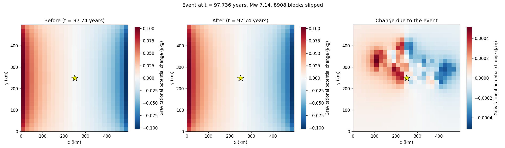
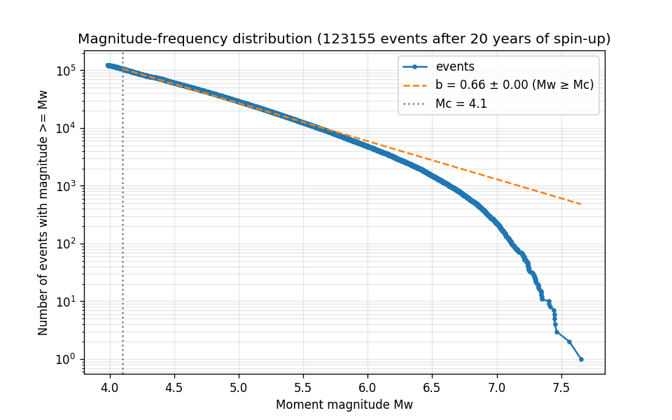

# Burridge-Knopoff Earthquake Simulation with Gravity Sensors

A two-dimensional Burridge-Knopoff spring-block earthquake model, with an
array of gravity sensors that record the changes in gravitational potential
and gravity caused by the motion of the fault, optional Earth-tide forcing by
the Moon and the Sun, and tools from nonlinear dynamics to study it.

- 250 × 250 blocks (a 500 km × 500 km fault patch) loaded by a plate moving at
  9 cm/year, with heterogeneous friction
- event-driven integration: the default 100-year run takes about 3 minutes and
  about 130 MB of memory (a 100 × 100 grid: about 10 s)
- an event catalogue with seismic moment and moment magnitude, and
  magnitude-frequency statistics (b-value, completeness, local slopes)
- exact potential and gravity changes at a 25 × 25 sensor array (one every 20 km) 5 km above the fault
- Earth tides (Moon and Sun): tidal shear, unclamping and body force on the blocks, steps of at
  most one hour between events, tidal statistics of the catalogue
- an animation of the gravity in the year before an event, one frame per hour (tides removed)
- nonlinear dynamics: Lyapunov exponents, embedding, recurrence, synchronisation and
  information flow (with the CaMI toolbox)
- NPZ/CSV output, animations, event maps and magnitude-frequency plot
- 185 tests (plus time/memory/statistics budgets), including analytic checks of the dynamics



## Quick start

```bash
pip install -r requirements.txt
python main.py                       # defaults from config.py, about 4-7 min with plots
python main.py --nx 50 --ny 50 --years 50 --output small_run
python main.py --help
```

Results go to `output/data` (data) and `output/plots` (figures and animation).

From Python:

```python
from burridge_knopoff import SimulationConfig, run, save_results

result = run(SimulationConfig(n_blocks_x=50, n_blocks_y=50, simulation_years=100, seed=1),
             progress=True)   # optional progress bar (simulated years, event count)
print(len(result.events), max(e.magnitude for e in result.events))
result.potentials            # (samples, sensors) potential change, J/kg
result.gravity               # (samples, sensors) change of the downward gravity, m/s^2
result.catalogue             # structured array of events

tidal = run(SimulationConfig(n_blocks_x=50, n_blocks_y=50, tides=True))   # Moon and Sun tides
save_results(result, 'my_run')
```

## Requirements

- Python 3.9 or later
- numpy (≥ 1.22), numba (≥ 0.56), matplotlib (≥ 3.5), tqdm (≥ 4.40, progress bar): `pip install -r requirements.txt`,
  or `pip install .` to also get the `burridge-knopoff` command
- optional: FFmpeg for an MP4 animation (otherwise a GIF is written; the
  pre-seismic animation needs it)
- optional, for `burridge_knopoff.dynamics`: scipy, and for information flow
  [cami](https://github.com/artvalencio/cami-python) ≥ 1.5 and
  [coupledlogistic](https://github.com/artvalencio/coupledlogistic) (`pip install .[dynamics]`)

## The model

Each block *i* sits on the fault plane z = 0 and slides along x, the direction
of plate motion. Its displacement from the reference grid is uᵢ and its velocity
vᵢ ≥ 0. The forces on it are

| Force | Expression |
|---|---|
| coupling springs (free edges) | Σⱼ k_ij (uⱼ − uᵢ); by default k_ij = k_c for the 4 nearest neighbours |
| loading ("leaf") spring to the plate | k_p (x_p(t) − uᵢ), x_p(t) = x_p(0) + v_p t |
| friction | stuck: holds the block up to its strength F_s,i; slipping: f_i(v) against the motion, by default F_d |

The plate starts at x_p(0) = F_d/k_p, so every block starts at the dynamic
friction level. Strengths are heterogeneous, F_s,i = F_d + (F_s − F_d)·U[1 − h, 1 + h],
drawn with a seed. By default a block that has slipped heals with a new
strength, never below the load it holds when it stops.

**Optional physics.**

- **Velocity-weakening friction** (`weakening_velocity_m_s` = v_w, `onset_drop` = s,
  after Carlson & Langer, 1989). While a block slips, friction is

      f_i(v) = F_d + (1 − s)(F_s,i − F_d) / (1 + v / v_w)

  It drops by the fraction s of the strength excess when slip starts (that drop
  is what lets slip begin), then weakens towards F_d as the block speeds up.
  Very slow weakening behaves like constant friction at the onset level; very
  fast weakening tends to the default F_d. Both limits are tested.
- **Long-range stress transfer** (`interaction_range_blocks` = R,
  `interaction_exponent` = p, default 3). Every pair of blocks within R
  spacings is coupled with k_ij = k_c (L/r_ij)^p. With p = 3 this is the 1/r³
  decay of static stress transfer in an elastic body. R = 1 is the classic
  nearest-neighbour model; R = 3 couples 28 blocks, R = 5 couples 80.

**Event-driven integration.** While all blocks are stuck, only the plate moves
and every force grows at the rate k_p v_p. The time until the weakest block
fails is therefore known exactly, and the simulation jumps there. The slip is
then integrated with velocity Verlet, only for the slipping blocks, with steps
of 1/100 of the fastest oscillation period. A block stops when its velocity
returns to zero with its force within its strength; a stuck neighbour starts
when its force exceeds its strength. The event ends when no block moves.

**Events.** The hypocentre is the first failing block. The seismic moment is
M₀ = μ · A · Σ slip (shear modulus, block area), and the moment magnitude is
Mw = (2/3)(log₁₀ M₀ − 9.1).

**Gravity.** Each block is a point mass m, and the sensors record

    ΔΦ_s = −G m Σ_b ( 1/|r_s − r_b − u_b x̂| − 1/|r_s − r_b| ).

Blocks are stuck between events, so ΔΦ only changes at events. After each
event it is updated from the slipped blocks alone. Every term is evaluated in
a cancellation-free form, never as the difference of two large totals. The
acceleration is g = −∇Φ, pointing towards the masses (`gravity.acceleration`).
The sensors also record the change of the downward gravity a gravimeter
measures, Δg_s = G m Σ_b d_z (1/|r_s − r_b − u_b x̂|³ − 1/|r_s − r_b|³),
computed in the same pass and in the same cancellation-free way. Each event's
co-seismic step is summarised in the catalogue (largest and RMS |Δg| over the
sensors); events above `gravity_map_min_magnitude` keep their full maps.

## Earth tides

With `tides=True` (`--tides`), the Moon and the Sun deform the Earth and load
the fault (`burridge_knopoff/tides.py`):

- **Positions** of the bodies from low-precision analytic series (Meeus, 1998;
  ~0.01° for the Moon), rotated to the Earth-fixed frame by the sidereal time.
- **Tidal potential** (degree 2, and 3 for the Moon) and the **strain** of the
  elastic Earth from the Love/Shida numbers h₂, l₂; plane **stress** at the free
  surface (σ ≈ 2μ ε), a few kPa.
- **On the fault** (nominal orientation, default the 2011 Tohoku-oki mechanism,
  strike 203°, dip 10°, rake 88°, centred at 38.3° N, 143° E): the shear
  stress τ along the slip drives the blocks, the normal stress σ_n (tension
  positive) unclamps them, lowering the static strength by μ_s σ_n A and the
  sliding friction by μ_d σ_n A, and the tidal acceleration acts on the block
  masses (about 1 % of the stress term). On a 10° thrust the shear is ±~0.4 kPa
  and the normal stress ±~0.07 kPa.
- **Integration.** The tide is tabulated every `tide_step_hours` (at most 1 h
  by default) on a 3 × 3 grid of control points, fitted linearly over the area,
  and interpolated by cubics in between. Between events the plate is stepped
  through the table, and the first failure inside a step is found exactly on
  the interpolated tide, so no short excursion above the strength is missed.
  During an event (seconds) the tide is frozen.
- **Statistics** (`burridge_knopoff.tide_analysis`): the catalogue records the
  tide at each hypocentre and its semidiurnal phase; `tidal_statistics` gives
  the Schuster test and the event rate per tidal-stress decile, and applies
  the same tide to a run without tides as a null control.

The harmonic constituents of the computed tide match Cartwright & Edden (1973)
(M2/S2 2.150, K1/O1 1.406 over a nodal cycle), and the tidal gravity spans
about 300 µGal peak to peak at the site.

## Pre-seismic gravity

`python main.py --preseismic [EVENT]` replays the run up to an event (the
largest after the spin-up by default; runs are deterministic for a seed) and
records the sensors every hour of the year before it
(`burridge_knopoff.preseismic.replay`). The animation
(`visualization.preseismic_animation`, MP4) shows the gravity change since
the start of the window; with tides it shows the gravity residuals, the tide
removed exactly (`--tide-removal model`) or by a least-squares fit of the main
constituents as for real data (`fit`). The series at the sensor nearest the
hypocentre runs below the map. In the 2-D model the field only changes at
the events of the window: blocks are stuck in between.

## Nonlinear dynamics

`burridge_knopoff.dynamics` (plan: `3d_model/PLAN.md`, section 6):

| Module | Content |
|---|---|
| `lyapunov` | spectrum of the event-to-event map on small grids (Kaplan-Yorke dimension), two-trajectory and finite-size exponents, predictability horizon; Rosenstein and Kantz estimators from data |
| `embedding` | delay vectors, auto-mutual information, false nearest neighbours, Cao, correlation dimension |
| `recurrence` | recurrence plots, RQA (DET, LAM, ...), windowed and joint recurrence |
| `synchronization` | event phases, phase locking, Kuramoto order, event synchronisation, rotation numbers |
| `information` | transfer-entropy networks, pair flow and pooled windows through the CaMI toolbox |
| `ordinal`, `surrogates`, `observables` | permutation entropy and complexity-entropy plane; IAAFT and event surrogates; series from runs |

Lyapunov exponents need a deterministic model (`redraw_thresholds=False`) or
shared noise (`rng_mode='per-block'`: the k-th strength of each block depends
only on the seed, the block and k). The estimators are validated on the Hénon
map, the Lorenz system and coupled logistic maps. An 8 × 8 deterministic grid
is chaotic: λ₁ ≈ 0.56 per year (Kaplan-Yorke dimension 13.5), the same from the
event map and from two trajectories.

## Configuration

`config.py` holds the defaults used by `main.py`. Every field name carries its
unit; the documentation is `help(burridge_knopoff.SimulationConfig)`.

| Group | Fields (defaults) |
|---|---|
| grid | `n_blocks_x`, `n_blocks_y` (250, 250), `block_spacing_m` (2000), `seismogenic_thickness_m` (10 km), `rock_density_kg_m3` (2700) → block mass 1.08·10¹⁴ kg |
| springs | derived from the geometry: coupling k_c = μ·H (3·10¹⁴ N/m), loading k_p = μ·L²/`loading_distance_m` (20 km → 6·10¹² N/m), so k_c/k_p = 50; `coupling_stiffness_n_m` / `loading_stiffness_n_m` override them |
| friction | `static_friction_stress_pa` (10 MPa), `dynamic_friction_stress_pa` (7 MPa), `heterogeneity` (0.5), `redraw_thresholds` (True), `weakening_velocity_m_s` (None: off), `onset_drop` (0.2) |
| coupling range | `interaction_range_blocks` (1: nearest neighbours), `interaction_exponent` (3) |
| loading | `plate_velocity_m_per_year` (0.09), `shear_modulus_pa` (30 GPa, for the moment) |
| sensors | `n_sensors_x`, `n_sensors_y` (25, 25), `sensor_height_m` (5000) |
| gravity maps | `gravity_map_min_magnitude` (6.5): events at least this large keep their full co-seismic maps |
| tides | `tides` (False), `tide_bodies` ('moon,sun'), `tide_stress`, `tide_body_force` (True), `tide_scale` (1), `tide_step_hours` (1), `tide_spatial` ('linear'), `epoch_utc`, `centre_latitude_deg`, `centre_longitude_deg`, `fault_strike_deg`, `fault_dip_deg`, `fault_rake_deg`, `friction_coefficient` (0.6), `love_h2`, `love_l2`, `love_k2`, `poisson_ratio`, `skempton_b` |
| dynamics | `rng_mode` ('global' or 'per-block'), `n_regions_x`, `n_regions_y` (5, 5: per-event regional moments), `record_energy` (False) |
| schedule | `simulation_years` (100), `sample_interval_years` (0.01), `snapshot_interval_years` (1), `steps_per_period` (100), `spinup_years` (20, left out of the statistics), `seed` (0) |

The coupling spring is the elastic stiffness of the slab between two blocks
(shear modulus × cross-section H·L / distance L). The loading spring is the
shear of a block's column over the depth D at which the plate loads the
fault. Their ratio sets how far stress travels: the correlation length is
about √(k_c/k_p) ≈ 7 blocks. `SimulationConfig.check_parameters()` warns when a
configuration would produce no events in the simulated time.

Command-line options override the grid, sensors, years, intervals, seed and
spin-up (`--spinup`) for one run, and turn on the optional physics:
`--weakening V_W DROP` and `--range R`. Tides: `--tides`, `--tide-scale S`,
`--tide-bodies moon sun`, `--tide-step HOURS`. Pre-seismic animation:
`--preseismic [EVENT]`, `--preseismic-years`, `--frame-hours`,
`--tide-removal model|fit`. Others: `--output DIR`, `--stream` (write series to disk while
simulating), `--block-csv`, `--no-plots`, `--max-frames N`, `--no-progress` (hide the
progress bar, which shows simulated years, the event count and the time
remaining). Exit status: 0 on
success, 1 if saving or plotting failed (the rest still runs), 2 for invalid
parameters.

## Outputs

In `output/data`:

| File | Content |
|---|---|
| `results.npz` | everything; reload with `burridge_knopoff.load_results(dir)` |
| `events.csv` | one row per event: start_years, duration_s, hypocentre (index, row, col, x_m, y_m), n_slipped, total_slip_m, max_slip_m, peak_velocity_m_s, moment_n_m, magnitude; co-seismic gravity (dg_max_abs_ugal, dg_rms_ugal, dg_max_sensor, dphi_max_abs); tide at the hypocentre (tide_shear_pa, tide_normal_pa, tide_coulomb_pa, tide_coulomb_rate_pa_h, tide_phase_rad; 0 without tides) |
| `sensor_potentials.csv` | time_years and one column per sensor (J/kg) |
| `sensor_gravity.csv` | time_years and one column per sensor (µGal, change of the downward gravity) |
| `preseismic_event_K.npz` | with `--preseismic`: the hourly frames of the window |
| `sensor_positions.csv`, `block_positions.csv` | coordinates, written once |
| `block_displacements.csv` | only with `--block-csv`: time and one column per block (m) |

In `output/plots`: `gravity_potential_animation.mp4` (or `.gif`),
`event_N_comparison.png` for the three largest events,
`magnitude_frequency.png`, and with `--preseismic` `preseismic_event_K.mp4`.

Indexing convention: per-block arrays are row-major, block = row × n_blocks_x
+ column, with columns along x and rows along y. Sensors follow the same rule.

## Performance

| Default run (100 × 100 blocks, 100 years) | Version 1 | Version 2 |
|---|---|---|
| simulation | did not finish: ~10⁹ explicit RK45 steps (a 3 × 3 grid took > 5 min for 0.03 years) | 9.5 s, 20,766 events |
| memory | 4.8 GB for stored positions and velocities, tens of GB for the CSV export | 21 MB peak |
| output | ~7 GB of CSV | 37 MB (data) + 2 MB (plots) |

The default grid is now 250 × 250 blocks (500 km × 500 km) with 25 × 25 sensors:
124,577 events in 100 years, 190–360 s on the same machine (measured spread;
about 240 s with the gravity kernel), 130 MB peak memory, 225 MB of data and 7 MB
of plots. With tides: about 380 s (the tide table is built once per process and
reused by the seeds of an ensemble). Per-event work includes
a few O(n) steps (the next failure, the plate shift), so time grows faster
than the number of blocks.

What makes it fast:
- exact jumps between events;
- compiled slip dynamics for the slipping blocks only;
- incrementally maintained forces;
- gravity updated from the slipped blocks only;
- vectorised, chunked output.

`--stream` keeps memory bounded for long series. Many seeds can run in
parallel with `run_ensemble(config, seeds, n_jobs)`; results don't depend on
`n_jobs`. Benchmarks: `python benchmarks/run.py LABEL`.

## Validation

The tests check, among other things:
- **Single block:** the stick-slip cycle matches the analytic solution. Failure comes after (F_s − F_d)/(k_p v_p); slip is 2(F_s − F_d)/k_p, lasting half a period π/ω; peak velocity is (F_s − F_d)ω/k_p; recurrence is 2(F_s − F_d)/(k_p v_p).
- **Energy balance during events:** plate work equals the change in elastic energy plus friction dissipation, to 10⁻³.
- **Forces:** Newton's third law, and springs connecting only true neighbours, on non-square grids.
- **Gravity:** point-mass potential, superposition, g = −∇Φ, potential changes against a 50-digit reference, incremental updates against full recomputation.
- **Reproducibility:** seeds reproduce runs exactly, and a golden 8 × 8 × 100-year run guards refactoring.
- **Statistics tools:** the b-value estimators recover known b on synthetic Gutenberg-Richter catalogues, including the truncated estimator used in finite windows.
- **Robustness:** plots work with no events and with all-zero potentials.
- **Tides:** ephemerides against Meeus' worked examples; the potential is harmonic and its
  gradient is the acceleration; the areal strain follows the Love numbers; constituent
  ratios over a nodal cycle; the linear fit represents the area to 2 %.
- **Tidal integration:** zero tide with hourly stepping reproduces the exact jumps; a single
  block under a sinusoidal tide fails at the exact first crossing; shorter steps converge to
  the exact sinusoid; energy balance with the tidal work; no block left above its strength.
- **Gravity:** Δg against a direct sum and a 50-digit reference.
- **Replays and runner:** replays reproduce the catalogue; frames agree with the regular
  samples; advancing in pieces and restoring snapshots give the same future.
- **Dynamics:** Hénon and Lorenz exponents and dimensions, RQA of sine vs noise, coupled
  logistic links, forced phase locking, event map vs two trajectories.

**Magnitude statistics.** `burridge_knopoff.analysis` estimates the b-value
by maximum likelihood (Aki, 1965), and uses the truncated estimator of Page
(1968) for finite windows. It also gives the magnitude of completeness Mc
and local b-values in one-unit windows. Events in the first `spinup_years`
are left out: every block starts at the same stress, so the first event
ruptures the whole grid (Mw 8.7 at 11 years in the default run). For the default
500 km run (events after 20 years):



- b = 0.66 ± 0.002 above Mc = 4.1 (106,127 events; largest Mw 7.65)
- local b: 0.57 (Mw 4.1–5.1), 0.59, 0.69, 0.73, 0.87 (6.1–7.1), then 1.64 and
  3.39: the power law holds over about three magnitude units, then is cut off.
  The 200 km grid (100 × 100) gave the same b (0.66 above Mc = 4.1; local b
  0.56–0.81, then 1.75): the 2.5× larger patch adds events, not a different
  distribution

Real faults typically show b ≈ 0.8–1.2. With the default friction and
nearest-neighbour coupling, this model's b ≈ 0.6–0.8 is robust to the
heterogeneity (0.2–0.9) and to the healing rule. The optional physics changes
that (60 × 60 blocks, 150 years; b above Mc):

| Option | b | Local slopes | Time |
|---|---|---|---|
| none (default) | 0.66 ± 0.01 | 0.57–0.69, then cut off | 6 s |
| `--weakening 0.1 0.3` | **0.97 ± 0.01** (other seed: 0.97; 100 × 100: 1.14) | 0.85–1.05, one power law | 3 s |
| `--weakening 0.05 0.3` | 1.27 ± 0.01 | 1.06–1.43 | 3 s |
| `--weakening 0.2 0.3` | 0.60 ± 0.01 | 0.46–0.71, then steep: excess of large "characteristic" events | 12 s |
| `--range 3` | 0.71 ± 0.01 | 0.53–0.80 | 32 s |
| `--range 5` | 0.74 ± 0.01 | 0.62–0.82 | 98 s |
| `--range 3 --weakening 0.1 0.3` | 0.80 ± 0.01 | 0.68–0.85 | 21 s |

- **Velocity weakening** (Carlson & Langer, 1989) produces a single power law
  with b ≈ 1 when the weakening velocity is about 0.1 m/s. The onset drop
  matters little between 0.2 and 0.5. Faster weakening (larger v_w) gives the
  known Carlson-Langer regime: many small events plus an excess of large,
  characteristic ones. The weakening velocity therefore acts as a dial on b,
  so b ≈ 1 is a calibration, not a prediction of the model.
- **Long-range stress transfer** barely changes b (0.71–0.74). It makes the
  stress field smoother, and it is costlier: forces are updated incrementally
  during slip, but each moving block still touches every coupled block.

Version 2.0 used much weaker coupling (k_c/k_p = 2.5). Its distribution was
cut off about one magnitude unit above Mc (local b 1.6, then 3.9). The
"b ≈ 2" quoted for it came from fitting one line across the power law and the
cutoff together; the estimators above separate the two.

```bash
pip install -e .[test]
pytest              # 185 fast tests
pytest -m slow      # time/memory budgets and long-run statistics
```

## Tides: first results

`3d_model/experiments/tides_comparison.py` runs ensembles with and without
tides. On a 100 km grid (50 × 50 blocks, 100 years after a 20-year spin-up,
10 seeds; each condition against its control):

| Condition | Events | b | Schuster p | vs control |
|---|---|---|---|---|
| A: no tides | 5962 | 0.689 | 0.41 | |
| B: hourly stepping, zero tide | 6034 | 0.687 | 0.44 | +72 [−1, 155] vs A |
| C: Moon + Sun | 6054 | 0.686 | ≈ 0 | +20 [−88, 122] vs B |
| tides × 1000 (5 seeds) | 6007 | 0.690 | ≈ 0 | −26 [−141, 89] vs B |

Tides do not change the number of events or the b-value detectably, even
amplified a thousand times, but they lock the timing of the events: none
occur in the lowest tidal-stress deciles. A threshold (Coulomb) model has no
nucleation delay, so it overstates this locking compared with real faults.
The cumulative co-seismic gravity change (±250 µGal over 100 years) differs
by less than 1 % with tides. The model is chaotic, so runs with the same seed
decorrelate and conditions are compared as independent samples.

## Nonlinear dynamics: first results

`3d_model/experiments/nonlinear_analysis.py` (100 km grid unless stated):

- **Chaos is extensive.** On deterministic grids of 4 to 144 blocks the
  Kaplan-Yorke dimension of the event map grows with the grid (2.2, 5.4, 7.1,
  13.5, 13.7, 22.2), about 0.15 per block on the larger grids: the 500 km model
  has no low-dimensional attractor, and ordinal patterns of its inter-event
  times look like noise (normalised permutation entropy ≈ 1).
- **Predictability.** λ₁ ≈ 2 per year for the deterministic 50 × 50 grid
  (25 per year with per-block noise). After a perturbation of 10⁻⁹ of the
  strength excess, catalogues stay identical for about 4 years (median), and
  for 6 years for events of Mw ≥ 6.5.
- **Synchronisation.** The phase locking of regional large events falls with
  distance (0.53 at 20 km, 0.22 at 113 km), as the coupling does.
- **No precursor in the recurrence structure.** The recurrence quantification of
  the elastic energy in the year before Mw ≥ 6.5 events does not differ from
  random windows (DET 0.22 vs 0.23, p = 0.58).
- **Information flow.** Weekly regional moment series carry no detectable
  transfer entropy between regions (6 % of links significant at the 5 % level):
  stress passes between regions within an event, faster than the bins.

## Limitations

- The model is a simplified Burridge-Knopoff system: a single layer of blocks
  with springs and static/dynamic (optionally velocity-weakening) friction.
  Long-range coupling is truncated at a finite range. There is no
  rate-and-state friction, and no wave radiation.
- Parameters are mutually consistent, not calibrated to a particular fault.
- Blocks are point masses for gravity; only their slip along x changes the
  potential.
- Sensor samples falling inside an event (which lasts seconds) show the state
  after the event.
- Tides: solid-Earth body tide only (no ocean loading, which can dominate near
  trenches); the flat 2-D fault uses a nominal orientation to resolve the
  tidal stress; spherical, elastic Earth response from Love numbers.

## Project structure

```
burridge-knopoff/
├── main.py, config.py        # command line and editable defaults
├── burridge_knopoff/
│   ├── config.py             # SimulationConfig
│   ├── grid.py               # index conventions, coordinates
│   ├── model.py              # forces, loading, slip kernel (numba)
│   ├── gravity.py            # potential and gravity changes at the sensors
│   ├── tides.py              # Moon and Sun tides: potential, strain, stress on the fault
│   ├── tide_analysis.py      # Schuster test, rate vs tidal stress
│   ├── preseismic.py         # hourly replays before events, tide removal
│   ├── dynamics/             # Lyapunov, embedding, recurrence, synchronisation, information
│   ├── events.py             # catalogue, moment, magnitude
│   ├── analysis.py           # b-value, completeness, local slopes
│   ├── simulation.py         # Runner, run, run_ensemble, SimulationResult
│   ├── output.py             # NPZ/CSV save and load
│   ├── visualization.py      # animation and plots
│   └── cli.py                # command-line interface
├── tests/                    # pytest suite (golden_catalogue.json: golden run)
├── 3d_model/PLAN.md          # plan: 3-D half-space model, Earth tides, tide comparison
├── 3d_model/experiments/     # tides_comparison.py, nonlinear_analysis.py
└── benchmarks/run.py         # timings and memory peaks
```

## References

1. Burridge, R., & Knopoff, L. (1967). Model and theoretical seismicity. *Bulletin of the Seismological Society of America*, 57(3), 341-371.
2. Carlson, J. M., & Langer, J. S. (1989). Mechanical model of an earthquake fault. *Physical Review A*, 40(11), 6470-6484.
3. Hanks, T. C., & Kanamori, H. (1979). A moment magnitude scale. *Journal of Geophysical Research*, 84(B5), 2348-2350.
4. Aki, K. (1965). Maximum likelihood estimate of b in the formula log N = a − bM and its confidence limits. *Bulletin of the Earthquake Research Institute*, 43, 237-239.
5. Page, R. (1968). Aftershocks and microaftershocks of the great Alaska earthquake of 1964. *Bulletin of the Seismological Society of America*, 58(3), 1131-1168.
6. Scholz, C. H. (2002). *The Mechanics of Earthquakes and Faulting* (2nd ed.). Cambridge University Press.

## License

This project is provided for educational and research purposes.

---

**Note**: this is a simplified model for research and education. Real
earthquake forecasting requires far more complex models (3-D geometry,
heterogeneous materials, fluids and more).
