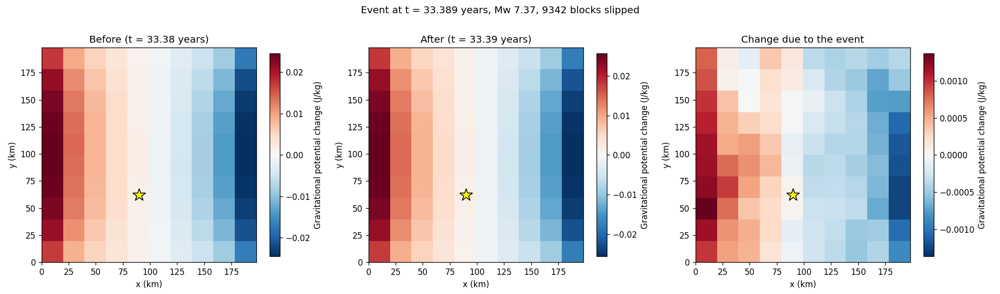
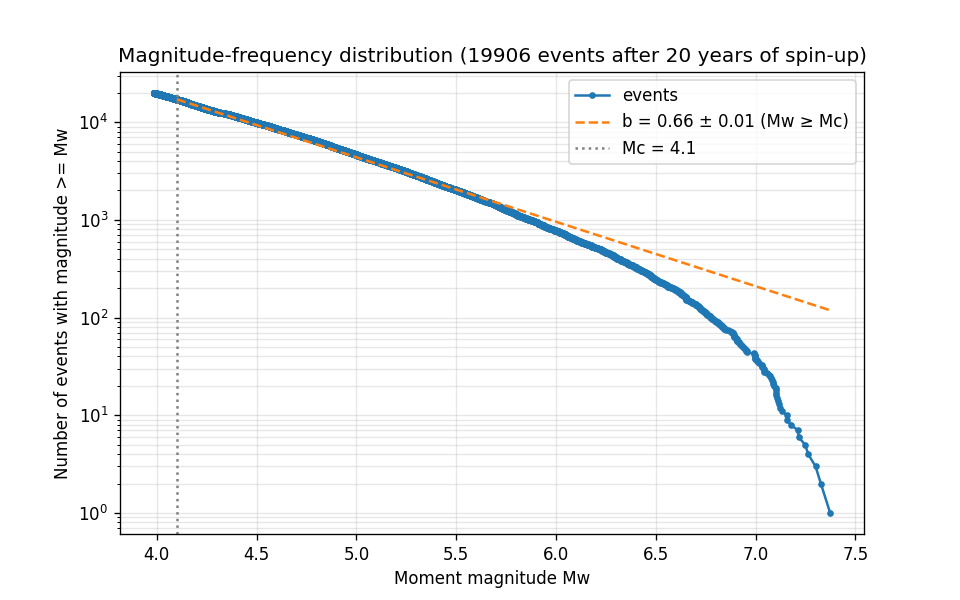

# Burridge-Knopoff Earthquake Simulation with Gravity Sensors

A two-dimensional Burridge-Knopoff spring-block earthquake model, with an
array of gravity sensors that record the change in gravitational potential
caused by the motion of the fault.

- 100 × 100 blocks (a 200 km × 200 km fault patch) loaded by a plate moving at
  9 cm/year, with heterogeneous friction
- event-driven integration: the default 100-year run takes about 10 s and
  about 20 MB of memory
- an event catalogue with seismic moment and moment magnitude, and
  magnitude-frequency statistics (b-value, completeness, local slopes)
- exact potential changes at a 10 × 10 sensor array 5 km above the fault
- NPZ/CSV output, animation, event maps and magnitude-frequency plot
- 100 tests (plus time/memory/statistics budgets), including analytic checks of the dynamics



## Quick start

```bash
pip install -r requirements.txt
python main.py                       # defaults from config.py, about 40 s with plots
python main.py --nx 50 --ny 50 --years 50 --output small_run
python main.py --help
```

Results go to `output/data` (data) and `output/plots` (figures and animation).

From Python:

```python
from burridge_knopoff import SimulationConfig, run, save_results

result = run(SimulationConfig(n_blocks_x=50, n_blocks_y=50, simulation_years=100, seed=1))
print(len(result.events), max(e.magnitude for e in result.events))
result.potentials            # (samples, sensors) potential change, J/kg
result.catalogue             # structured array of events
save_results(result, 'my_run')
```

## Requirements

- Python 3.9 or later
- numpy (≥ 1.22), numba (≥ 0.56), matplotlib (≥ 3.5): `pip install -r requirements.txt`,
  or `pip install .` to also get the `burridge-knopoff` command
- optional: FFmpeg for an MP4 animation (otherwise a GIF is written)

## The model

Each block *i* sits on the fault plane z = 0 and slides along x, the direction
of plate motion. Its displacement from the reference grid is uᵢ and its velocity
vᵢ ≥ 0. The forces on it are

| Force | Expression |
|---|---|
| coupling springs to its 4 neighbours (free edges) | k_c Σⱼ (uⱼ − uᵢ) |
| loading ("leaf") spring to the plate | k_p (x_p(t) − uᵢ), x_p(t) = x_p(0) + v_p t |
| friction | stuck: holds the block up to its strength F_s,i; slipping: F_d against the motion |

The plate starts at x_p(0) = F_d/k_p, so every block starts at the dynamic
friction level. Strengths are heterogeneous, F_s,i = F_d + (F_s − F_d)·U[1 − h, 1 + h],
drawn with a seed. By default a block that has slipped heals with a new
strength, never below the load it holds when it stops.

**Event-driven integration.** While all blocks are stuck, only the plate moves
and every force grows at the rate k_p v_p. The time until the weakest block
fails is therefore known exactly, and the simulation jumps there. The slip is
then integrated with velocity Verlet, only for the slipping blocks, with steps
of 1/100 of the fastest oscillation period. A block stops when its velocity
returns to zero with its force within its strength; a stuck neighbour starts
when its force exceeds its strength. The event ends when no block moves.

**Events.** The hypocentre is the first failing block. The seismic moment is
M₀ = μ · A · Σ slip (shear modulus, block area), and the moment magnitude is
Mw = (2/3)(log₁₀ M₀ − 9.1).

**Gravity.** Each block is a point mass m, and the sensors record

    ΔΦ_s = −G m Σ_b ( 1/|r_s − r_b − u_b x̂| − 1/|r_s − r_b| ).

Blocks are stuck between events, so ΔΦ only changes at events. After each
event it is updated from the slipped blocks alone. Every term is evaluated in
a cancellation-free form, never as the difference of two large totals. The
acceleration is g = −∇Φ, pointing towards the masses (`gravity.acceleration`).

## Configuration

`config.py` holds the defaults used by `main.py`. Every field name carries its
unit; the documentation is `help(burridge_knopoff.SimulationConfig)`.

| Group | Fields (defaults) |
|---|---|
| grid | `n_blocks_x`, `n_blocks_y` (100, 100), `block_spacing_m` (2000), `seismogenic_thickness_m` (10 km), `rock_density_kg_m3` (2700) → block mass 1.08·10¹⁴ kg |
| springs | derived from the geometry: coupling k_c = μ·H (3·10¹⁴ N/m), loading k_p = μ·L²/`loading_distance_m` (20 km → 6·10¹² N/m), so k_c/k_p = 50; `coupling_stiffness_n_m` / `loading_stiffness_n_m` override them |
| friction | `static_friction_stress_pa` (10 MPa), `dynamic_friction_stress_pa` (7 MPa), `heterogeneity` (0.5), `redraw_thresholds` (True) |
| loading | `plate_velocity_m_per_year` (0.09), `shear_modulus_pa` (30 GPa, for the moment) |
| sensors | `n_sensors_x`, `n_sensors_y` (10, 10), `sensor_height_m` (5000) |
| schedule | `simulation_years` (100), `sample_interval_years` (0.01), `snapshot_interval_years` (1), `steps_per_period` (100), `spinup_years` (20, left out of the statistics), `seed` (0) |

The coupling spring is the elastic stiffness of the slab between two blocks
(shear modulus × cross-section H·L / distance L). The loading spring is the
shear of a block's column over the depth D at which the plate loads the
fault. Their ratio sets how far stress travels: the correlation length is
about √(k_c/k_p) ≈ 7 blocks. `SimulationConfig.check_parameters()` warns when a
configuration would produce no events in the simulated time.

Command-line options override the grid, sensors, years, intervals, seed and
spin-up (`--spinup`) for one run. Others: `--output DIR`, `--stream` (write series to disk while
simulating), `--block-csv`, `--no-plots`, `--max-frames N`. Exit status: 0 on
success, 1 if saving or plotting failed (the rest still runs), 2 for invalid
parameters.

## Outputs

In `output/data`:

| File | Content |
|---|---|
| `results.npz` | everything; reload with `burridge_knopoff.load_results(dir)` |
| `events.csv` | one row per event: start_years, duration_s, hypocentre (index, row, col, x_m, y_m), n_slipped, total_slip_m, max_slip_m, peak_velocity_m_s, moment_n_m, magnitude |
| `sensor_potentials.csv` | time_years and one column per sensor (J/kg) |
| `sensor_positions.csv`, `block_positions.csv` | coordinates, written once |
| `block_displacements.csv` | only with `--block-csv`: time and one column per block (m) |

In `output/plots`: `gravity_potential_animation.mp4` (or `.gif`),
`event_N_comparison.png` for the three largest events, and
`magnitude_frequency.png`.

Indexing convention: per-block arrays are row-major, block = row × n_blocks_x
+ column, with columns along x and rows along y. Sensors follow the same rule.

## Performance

| Default run (100 × 100 blocks, 100 years) | Version 1 | Version 2 |
|---|---|---|
| simulation | did not finish: ~10⁹ explicit RK45 steps (a 3 × 3 grid took > 5 min for 0.03 years) | 9.5 s, 20,766 events |
| memory | 4.8 GB for stored positions and velocities, tens of GB for the CSV export | 21 MB peak |
| output | ~7 GB of CSV | 37 MB (data) + 2 MB (plots) |

What makes it fast:
- exact jumps between events;
- compiled slip dynamics for the slipping blocks only;
- incrementally maintained forces;
- gravity updated from the slipped blocks only;
- vectorised, chunked output.

`--stream` keeps memory bounded for long series. Many seeds can run in
parallel with `run_ensemble(config, seeds, n_jobs)`; results don't depend on
`n_jobs`. Benchmarks: `python benchmarks/run.py LABEL`.

## Validation

The tests check, among other things:
- **Single block:** the stick-slip cycle matches the analytic solution. Failure comes after (F_s − F_d)/(k_p v_p); slip is 2(F_s − F_d)/k_p, lasting half a period π/ω; peak velocity is (F_s − F_d)ω/k_p; recurrence is 2(F_s − F_d)/(k_p v_p).
- **Energy balance during events:** plate work equals the change in elastic energy plus friction dissipation, to 10⁻³.
- **Forces:** Newton's third law, and springs connecting only true neighbours, on non-square grids.
- **Gravity:** point-mass potential, superposition, g = −∇Φ, potential changes against a 50-digit reference, incremental updates against full recomputation.
- **Reproducibility:** seeds reproduce runs exactly, and a golden 8 × 8 × 100-year run guards refactoring.
- **Statistics tools:** the b-value estimators recover known b on synthetic Gutenberg-Richter catalogues, including the truncated estimator used in finite windows.
- **Robustness:** plots work with no events and with all-zero potentials.

**Magnitude statistics.** `burridge_knopoff.analysis` estimates the b-value
by maximum likelihood (Aki, 1965), and uses the truncated estimator of Page
(1968) for finite windows. It also gives the magnitude of completeness Mc
and local b-values in one-unit windows. Events in the first `spinup_years`
are left out: every block starts at the same stress, so the first event
ruptures the whole grid. For the default run (events after 20 years):



- b = 0.66 ± 0.01 above Mc = 4.1 (17,142 events)
- local b: 0.56 (Mw 4.1–5.1), 0.61, 0.66, 0.77, 0.81 (6.1–7.1), then 1.75: the
  power law holds over about three magnitude units, up to the size of the grid

Real faults typically show b ≈ 0.8–1.2. This model's b ≈ 0.6–0.8 is robust to
the heterogeneity (0.2–0.9) and to the healing rule: it is a property of
nearest-neighbour Coulomb spring-block models. Bringing it closer to 1 would
need velocity-weakening friction (Carlson & Langer, 1989) or long-range
elastic interactions.

Version 2.0 used much weaker coupling (k_c/k_p = 2.5). Its distribution was
cut off about one magnitude unit above Mc (local b 1.6, then 3.9). The
"b ≈ 2" quoted for it came from fitting one line across the power law and the
cutoff together; the estimators above separate the two.

```bash
pip install -e .[test]
pytest              # 100 fast tests
pytest -m slow      # time/memory budgets and long-run statistics
```

## Limitations

- The model is the classic, simplified Burridge-Knopoff system: blocks with
  nearest-neighbour springs and static/dynamic friction. It has no
  rate-and-state friction, no long-range elasticity and no wave radiation.
- Parameters are mutually consistent, not calibrated to a particular fault.
- Blocks are point masses for gravity; only their slip along x changes the
  potential.
- Sensor samples falling inside an event (which lasts seconds) show the state
  after the event.

## Project structure

```
burridge-knopoff/
├── main.py, config.py        # command line and editable defaults
├── burridge_knopoff/
│   ├── config.py             # SimulationConfig
│   ├── grid.py               # index conventions, coordinates
│   ├── model.py              # forces, loading, slip kernel (numba)
│   ├── gravity.py            # potential changes at the sensors
│   ├── events.py             # catalogue, moment, magnitude
│   ├── analysis.py           # b-value, completeness, local slopes
│   ├── simulation.py         # run, run_ensemble, SimulationResult
│   ├── output.py             # NPZ/CSV save and load
│   ├── visualization.py      # animation and plots
│   └── cli.py                # command-line interface
├── tests/                    # pytest suite (golden_catalogue.json: golden run)
└── benchmarks/run.py         # timings and memory peaks
```

## References

1. Burridge, R., & Knopoff, L. (1967). Model and theoretical seismicity. *Bulletin of the Seismological Society of America*, 57(3), 341-371.
2. Carlson, J. M., & Langer, J. S. (1989). Mechanical model of an earthquake fault. *Physical Review A*, 40(11), 6470-6484.
3. Hanks, T. C., & Kanamori, H. (1979). A moment magnitude scale. *Journal of Geophysical Research*, 84(B5), 2348-2350.
4. Aki, K. (1965). Maximum likelihood estimate of b in the formula log N = a − bM and its confidence limits. *Bulletin of the Earthquake Research Institute*, 43, 237-239.
5. Page, R. (1968). Aftershocks and microaftershocks of the great Alaska earthquake of 1964. *Bulletin of the Seismological Society of America*, 58(3), 1131-1168.
6. Scholz, C. H. (2002). *The Mechanics of Earthquakes and Faulting* (2nd ed.). Cambridge University Press.

## License

This project is provided for educational and research purposes.

---

**Note**: this is a simplified model for research and education. Real
earthquake forecasting requires far more complex models (3-D geometry,
heterogeneous materials, fluids and more).
